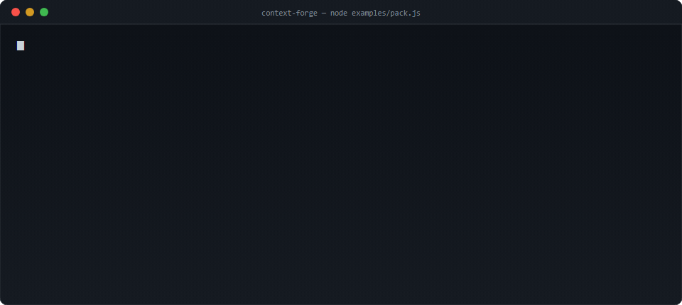

# Context Forge



<sub>Animated: the same run, one line at a time. Static version: [demo.svg](demo.svg)</sub>

**Package knowledge for AI agents — with proof of freshness.**

RAG systems rarely fail because of the model. They fail because of the context: 3,000 documents where 40 % are
duplicates, 20 % are outdated and 10 % contradict each other. The agent then cites a price list from 2023 and the
company loses money.

Context Forge is the **input side** of that problem: it ingests knowledge, removes duplicates, flags conflicts,
measures freshness for every fact, and emits a RAG pack where **every chunk carries a citation, an owner, a date
and a SHA-256 hash of its source**.

> AgentGuard protects the **effect** ("you may not refund 1,500").
> Context Forge protects the **input** ("you may not read the 2023 price list — here is the fresh one, with hash").

No dependencies. No cloud. Runs in under a second.

```
$ node examples/pack.js

1. ingest      312 sources (265 unique + 47 copies)
2. dedup       47 duplicates in 47 groups · 11 KB saved
3. conflicts   12 conflicts (they go to a human, not to an agent)
4. freshness   fresh 223 · stale 26 · expired 63 · no date 0 · >90 days 23.1%
5. pack        178 chunks with citation + hash · 134 dropped
6. report      risk: critical (309 points)
```

---

> **See real output first:** [DEMO.md](DEMO.md) — what it prints when it runs, and what each line proves.

## Why teams need it

| Problem | What Context Forge does |
|---|---|
| the same document lives in 4 places | **exact duplicates** by content hash, canonical = newest; near-duplicates by token similarity |
| two docs disagree on a price | **conflicts** (same key, different value) are never auto-resolved — they go to a human queue |
| nobody knows what is outdated | **freshness per type** (price list 30 days, contract 365) with a score an auditor can recompute |
| "where did the AI get this?" | every chunk carries **source, owner, date and sha256** — provenance, not a guess |
| management wants a number | one **report**: sources, duplicates removed, conflicts, % older than 90 days, risk level |

---

## 5-minute integration

```bash
git clone <this repo> && cd context-forge
node examples/pack.js      # the full flow, reproducible numbers, no network
npm test                   # 33 tests, no dependencies, ~1 s
```

```js
import { ingestor, deduper, freshness, packer } from 'context-forge';

const sources = ingestor('/data/knowledge');          // .md .txt .json .csv .yml
const clean   = deduper(sources);                     // duplicates removed, findings kept
const checked = freshness(clean, { ttlDana: 90 });    // age, conflicts, PII flags
const pack    = packer(checked, { pitanje: 'what is the refund price?' });
```

Feed the resulting `pack.json` (or `pack.md`) to your RAG indexer. Anything that is not in the pack is listed in
`izbaceno` **with the reason** — never silently dropped.

<!-- English aliases for the public API are exported from src/index.js as well:
     buildPack, matchScore, proofLine, summary, loadPolicy, detect, redact, FLAGS.
     The internals still use Serbian identifiers, because the 50 tests and 7 scenarios
     assert on those reason strings — renaming them would change observable behaviour.
     Use the English names; they are the same functions. -->

<details>
<summary>Prefer the low-level modules?</summary>

```js
import { usisajFolder } from './src/ingestor.js';
import { buildPack }   from './src/index.js';       // English alias of napraviPaket
```

Both surfaces are the same engine. The façade (`src/index.js`) is the stable one.
</details>

---

## What the pack contains

```json
{
  "id": "price/starter-001.md#1",
  "tekst": "# Starter — price ...",
  "citat": {
    "izvor": "price/starter-001.md", "tip": "price", "owner": "prodaja@firma",
    "updatedAt": "2026-09-30T00:00:00.000Z", "dateSource": "provided",
    "sha256": "9f2c…", "chunkHash": "41ab…"
  },
  "svezina": { "score": 0.53, "status": "stale", "ageDays": 14, "ttl": 30 }
}
```

| Field | Why it matters |
|---|---|
| `citat.sha256` | the **source** can be re-hashed later: if it changed, the pack is stale and you know it |
| `citat.chunkHash` | the exact chunk is verifiable, not just the document |
| `svezina.status` | `fresh` (< 60 % of TTL) · `stale` (60–100 %) · `expired` (> TTL) |
| `izbaceno[]` | every dropped source with a reason: `isteklo`, `duplikat`, `konflikt`, `nema datuma` |
| `konflikti[]` | the human queue: which key, which values, from which sources |
| `paketHash` | one hash over all chunks — the pack itself is verifiable |

---

## Policy (`policy.json`) — freshness as data, not code

```json
{ "ttlDaysByType": { "price": 30, "api": 60, "docs": 180, "contract": 365 },
  "freshness": { "staleAfterRatio": 0.6 },
  "pack": { "maxChunkChars": 900, "excludeExpired": true, "excludeConflicted": true } }
```

A client changes a price-list TTL from 30 to 14 days by editing one number — no deploy.

---

## Design decisions (the ones that matter)

1. **Unknown freshness is a risk, not a pass.** A source without a date is excluded and reported (`nema datuma`),
   because freshness that cannot be proven does not exist.
2. **Conflicts are never auto-resolved.** The newest value is not automatically "true" — the agent must not decide
   which department is right. It goes to a human queue, and conflicted sources stay out of the pack.
3. **Deduplication is by content hash, after normalisation** (whitespace, line endings) — so the same document
   saved twice, from two folders, is found.
4. **Append-only ingest.** Ingesting again changes nothing (`0 new`); a changed document adds a new record and
   keeps the old hash, so you can reconstruct what the agent could have read on any given day.
5. **Every exclusion has a reason.** Silent dropping is how RAG systems start hallucinating "missing" knowledge.

---

## Tests

```
33 tests · 33 pass
ingestor 6 · deduper 7 · freshness 6 · packer 9 · report 5
```

They caught two real bugs while this was built:
1. whitespace inside a line was **not** normalised → the same document produced two different hashes (dedup missed it);
2. the demo corpus produced 215 "duplicates" instead of 47, because every document shared the same template — fixed by
   putting a unique reference in each document (the demo numbers are now asserted by a test).

---

## Honest limitations

- Ingestion reads **local folders** today. Connectors (Drive, Notion, ticketing) are the next step; the source
  model (`id`, `owner`, `updatedAt`, `facts[]`) is already what a connector must fill.
- Conflict detection works on **structured `facts`** (`key` → `value`). Free text conflicts need an extractor
  (that is the next module, and it must be deterministic or clearly marked as a heuristic).
- Freshness measures **age against TTL**, not truth. A fresh document can still be wrong — which is why conflicts
  go to a human.
- No embeddings, no vector store: the pack is data, your indexer is your choice.

## License

MIT — see `LICENSE`.

---

## v1.0.0 — scenarios, question ranking, PII (added 14 Oct 2026)

| New | What it does | Proof |
|---|---|---|
| `scenarios/knowledge.json` | **7 scenarios stored as DATA** + a taxonomy (`duplicate`, `conflict`, `outdated`, `no-owner`, `no-source`, `sensitive`, `fresh`) | `node src/scenarios.js` → **7/7** + `reports/knowledge-scenarios-<day>.md` |
| Ranking by question | `packer(prov, { question: 'what is the refund price?' })` → `match` per chunk, sorted by `0.6*freshness + 0.4*match` | `examples/pack.js` section 3 (same knowledge, different order) |
| **PII in the loop** | `src/sensitive.js`: national ID, IBAN, card, phone, email, secrets, passwords → `flag: sensitive`, the finding is **redacted**, the source **never enters the pack** | scenario S6 + `test/sensitive.test.js` (6 tests) |
| Normalisation for matching | "price" finds "price" (diacritics + `ije→e`) | `test/index.test.js` |
| `src/index.js` (façade) | `ingestor / deduper / freshness / packer` in 4 lines of code | `examples/pack.js` section 4 |
| Demo on a **folder** | `data/knowledge/` (5 files: fresh, expired ×2, no owner, PII) | `examples/pack.js` section 1 |
| "No silent dropping" | a source that yields no chunk gets a reason in `dropped` | `test/index.test.js` |

**Tests: 50/50** · `npm test` ~1 s · flow `node examples/pack.js` **0.15 s** · still **0 dependencies**.

### What v1.0.0 found about itself (findings from work, not from wishes)
1. **The date in the header was being overridden by mtime** — the document claimed 2023, the machine read it as fresh. Text now wins (`dateSource: text`).
2. **A too-short source disappeared silently** (below `minChunkChars`) — a violation of the basic rule; now every output carries a reason, and the threshold is 20 characters.
3. **"price" did not match "price"** — the question returned an empty pack; normalisation was added (diacritics + `ije→e`).
4. **Scenario S1 expected a fresh canonical source, but the fixture was old** — proof that the runner verifies rather than stamps.